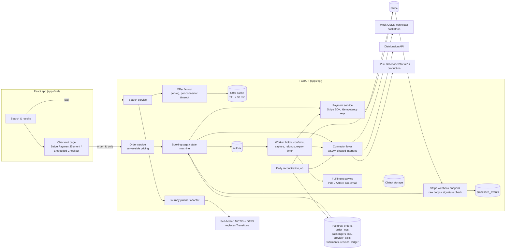
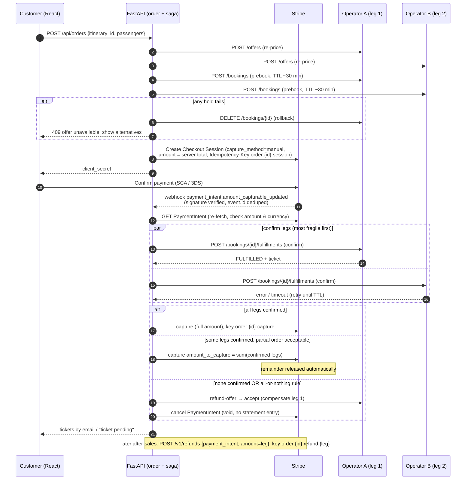

# Link Stripe payments to real rail tickets

**Bottom line:** No European rail operator lets an unknown startup sign up and issue real tickets on its own. Every route to real ticketing goes through a signed contract. Some operators add a bond, a sales threshold or a per-retailer UI review. The quickest real route is a wholesaler. **Distribusion** is the best fit for a startup: its API docs are public, it has a demo environment, and you get keys by emailing a partnership manager ([Distribusion docs](https://docs.distribusion.com/dt/api/getting-started/intro)). **Trainline Partner Solutions** has the deepest content but takes about 12 weeks to integrate and has no public sandbox ([TPS Global API](https://tps.thetrainline.com/our-products/global-api/)). The backend should treat each order as a saga: **authorize the card with Stripe manual capture, hold every leg, confirm each leg, then make one partial capture for the legs that were confirmed**. Stripe releases the rest of the authorization automatically ([Stripe: Place a hold](https://docs.stripe.com/payments/place-a-hold-on-a-payment-method)). Use OSDM nouns (offer, booking, fulfillment, refund offer) for the internal model, because OSDM is becoming the EU standard interface. It is not mandatory before **10 June 2029**, and even then it standardises the interface, not the commercial right to sell ([EC TTG 2026 slides](https://cdn.asp.events/CLIENT_CL_Conf_BDA05934_5056_B731_4C9EEBBE0C2416C2/sites/transport-ticketing-globa/media/2026-presentations/TTG-26-European-Commission-Digital-Rail-Ticketing....pdf)). For tomorrow's demo: mocked OSDM-shaped connectors, or Distribusion's demo environment if keys arrive in time, plus Stripe test mode with `capture_method=manual`. Also, **the app's current route source, Transitous, forbids commercial use**, so production needs a self-hosted MOTIS ([Transitous API policy](https://transitous.org/api/)).

---

## Today, every route to real tickets is gated by a contract

### Who lets us take payment and issue tickets

The classification assumes a startup that wants to **take the payment itself in Stripe and issue the ticket**. An affiliate link does not count, because there the operator takes the payment.

| Operator / distributor | Class | Access route | Conditions |
|---|---|---|---|
| **Distribusion** (wholesaler) | **ALLOWS** (after accreditation) | Retailer API: search, reservation create/confirm/cancel, bookings with tickets, demo environment. Keys from partner@distribusion.com ([docs](https://docs.distribusion.com/dt/api/getting-started/intro)) | 3 accreditation steps: general, carrier approval, carrier contracting. The retailer sets its markup and must show and charge it ([criteria](https://docs.distribusion.com/dt/api/getting-started/accreditation/criteria), [markup](https://docs.distribusion.com/dt/api/other-concepts/booking-fees/markup-fees)). Claims 40+ rail carriers ([OSDM connector](https://www.distribusion.com/de/osdm-connector-rail)) |
| **Trainline Partner Solutions** | **PARTIAL** | Global API with about 270 carriers, refunds, exchanges, delay info ([TPS](https://tps.thetrainline.com/our-products/global-api/), [Trainline API](https://www.thetrainline.com/solutions/api)) | Sold to large travel sellers. No public sandbox. About 12 weeks to integrate. Fees "negotiable" ([partnerships](https://www.thetrainline.com/about-us/partnerships)) |
| **Omio B2B** | **PARTIAL** | Booking API, Meta Search API, white label. The partner can be merchant of record ([Omio B2B](https://omio.com/corporate/omio-b2b/)) | Sales-gated. Page seen via search snippet only. Omio agreed to buy Rail Europe in July 2026 ([Skift](https://skift.com/2026/07/16/omio-to-buy-rail-europe-consolidating-ground-transport-exclusive/)) |
| **Rail Europe / SilverRail** | **PARTIAL** | B2B platform. SilverRail is in production on OSDM as a retailer ([OSDM implementations](https://osdm.io/tools/implementations/)) | B2B contract. Mostly older sources |
| **Trenitalia** | **PARTIAL** (the most obtainable direct contract) | OLTA reseller API. Apply at international.sales@trenitalia.it ([Trenitalia](https://www.trenitalia.com/en/information/join-online-and-become-a-trenitalia-partner.html)) | Guarantee bond. Commission rate not published. Through Distribusion, Trenitalia also reviews your UI flows in staging and asks what share of its content you will sell ([accreditation](https://docs.distribusion.com/dt/api/getting-started/accreditation/carrier-accreditation)) |
| **Eurostar** | **PARTIAL** | Partners API (REST/JSON, sales and after-sales) ([Eurostar for Agents](https://eurostarforagents.com/working-together/eurostar-api/)) | **£20k / €20k minimum annual sales**. Must capture Advance Passenger Information ([API notice](https://eurostarforagents.com/advance-passenger-information-now-live/)) |
| **ÖBB / Nightjet** | **PARTIAL** | Deeplink, then widget, then "Webservice Ticketshop" partial or full integration ([ÖBB](https://www.oebb.at/de/kooperationen/online-kooperationen)) | Full integration means processing payments for ÖBB and possibly a **bank guarantee** |
| **SBB** | **PARTIAL** | Swiss Mobility API ([GTC](https://company.sbb.ch/en/sbb-as-business-partner/services/digital-sales-solutions/sales-solutions/sbb-swiss-mobility-api/sbb-swiss-mobility-api-gtc.html)) | Contract ID and written approval. Bookings only, no timetable-only use. 2021 GTC, read from a search snippet |
| **SNCF / OUIGO** | **PARTIAL** | Bilateral deals (for example Trip.com, [TourMaG](https://www.tourmag.com/Trip-com-va-vendre-les-billets-de-train-SNCF_a128648.html)), Ravel/WDI for agencies, or wholesalers (TPS sells OUIGO, [BTM](https://thebusinesstravelmag.com/ouigo-france-tickets-now-easier-to-book/)) | No open onboarding. The SNCF Connect OSDM retailer role is still "implementing" ([OSDM](https://osdm.io/tools/implementations/)) |
| **DB** | **PARTIAL** | Contract only, or through Distribusion, Rail Europe or TPS ([Distribusion–DB tender](https://www.distribusion.com/news/distribusion-wins-tender-to-support-the-development-of-a-new-multi-carrier-sales-solution-for-deutsche-bahn)) | No public partner API. Commission is the subject of the Bundeskartellamt case below |
| **Renfe** | **PARTIAL**, leaning ALLOWS | Contract. EU commitments force full content and real-time data for platforms ([EC IP/24/201](https://ec.europa.eu/commission/presscorner/api/files/document/print/en/ip_24_201/IP_24_201_EN.pdf)) | Look-to-book caps of 600, 200 or 140. Still needs a distribution contract |
| **NS, SNCB** | **PARTIAL** | Benerail (in production on OSDM), SNCB International agency approval ([b-europe](https://www.b-europe.com/EN/Questions/Tickets)) | No public onboarding page found |
| **Italo, Iryo, Ouigo ES, RegioJet** | **PARTIAL** | Wholesalers only: TPS, Omio, Amadeus, All Aboard, Rail Europe ([TPS–Italo/Iryo](https://tps.thetrainline.com/blog-and-media/fairjungle-integrate-italo-renfe-and-iyro/)) | No direct programme found |
| **European Sleeper, WESTbahn** | **PARTIAL**, leaning ALLOWS | Distribusion is their open hub ([European Sleeper](https://www.distribusion.com/news/distribusion-technologies-partners-with-european-sleeper-to-increase-global-online-sales), [WESTbahn](https://distribusion.com/news/distribusion-technologies-partners-with-westbahn,-expanding-market-offerings-in-dach)) | Distribusion accreditation |
| **FlixTrain** | **PARTIAL**, leaning ALLOWS | Affiliate first, then "dynamic" tier (API, white label) on application ([Flix](https://www.flixbus.com/company/partners/affiliate-partners)) | Apply with traffic figures. Swiss affiliate pays 5% ([Awin](https://ui.awin.com/merchant-profile/13945)) |
| **UK (RDG)** | **PARTIAL** | Formal third-party licence: interim licence, then TPIL ([RDG](https://raildeliverygroup.com/our-services/retail-commercial/how-to-become-a-retailer/third-party-licences.html)) | **£10k + VAT non-refundable fee**, a bond sized on turnover, accreditation at about £1k/day ([costs](https://www.atoctravelagents.org/clientfiles/File/Entry%20costs%202023.pdf)) |
| **PKP Intercity** | **DOES NOT ALLOW** (for now) | UWH agency programme ([PKP IC](https://www.intercity.pl/en/uwh/)) | Intake frozen since 6 Nov 2024 while a new API is built. Requires 6 months on the market and a bank guarantee or deposit |
| **Transitous** (data, not tickets) | **DOES NOT ALLOW** commercial use | MOTIS API ([policy](https://transitous.org/api/)) | Non-commercial, best effort. More than 720 /plan calls a day needs coordination. Requires attribution |

**Affiliate fallbacks** need no contract, but the operator or affiliate merchant takes the payment, so Stripe cannot be used for the ticket. Examples: Eurostar and Trainline on Partnerize ([Eurostar](https://www.eurostar.com/uk-en/affiliate-marketing)), Rail Europe at about 0.91% on tickets ([Travelpayouts](https://travelpayouts.com/en/offers/raileurope-affiliate-program), third-party figure), Italo with a fixed fee on Awin ([Awin](https://ui.awin.com/merchant-profile/9685)), and free ÖBB deeplinks.

**Economics:** no verified reseller commission rate exists for point-to-point European rail. The one figure is SNCF's 2.7% B2B agency commission, and it comes from a search snippet ([L'Echo touristique](https://www.lechotouristique.com/article/sncf-nouvelle-convention-avec-les-agences-nouveaux-concurrents)). Plan revenue around **our own booking fee or markup charged through Stripe**, not around carrier commission.

### EU regulation helps with data and negotiating power, not with a right to sell

**Through-ticket liability (Reg. 2021/782 Art. 12)** is the rule that hits us on day one. Suppose we sell several operators' tickets in one transaction, combined on our own initiative. If the passenger misses a connection, we must refund the full amount **and pay 75% compensation**. The exception is when we clearly told the passenger before purchase that the tickets are separate contracts, and **the burden of proof is on us** (Art. 12(4)–(6), [OJ text](https://www.nationaltransport.ie/wp-content/uploads/2024/04/Rail-passengers-EU-Regulation-2021-782.pdf)). Claims must be paid within 30 days. So we must store which disclosure version each customer saw before payment.

**Competition cases** force incumbents to deal with platforms, but they do not open APIs:
- **Renfe (EC, 17 Jan 2024):** binding commitments to give platforms all content and real-time data on equal terms, with a monitoring trustee for 10 years ([EC](https://ec.europa.eu/commission/presscorner/api/files/document/print/en/ip_24_201/IP_24_201_EN.pdf)).
- **Bundeskartellamt v DB (June 2023):** DB must pay platforms a commission, share real-time data and drop advertising bans ([BKartA](https://bundeskartellamt.de/SharedDocs/Meldung/EN/Pressemitteilungen/2023/28_06_2023_DB_Mobilitaet.html)). The minimum-commission benchmark is **suspended** pending the main proceedings at OLG Düsseldorf ([BKartA 2024](https://bundeskartellamt.de/SharedDocs/Meldung/EN/AktuelleMeldungen/2024/11_03_2024_OLG_DB.html)). The 2026 ruling's outcome was not found.
- **France:** SNCF's 2014 commitments (14-D-11) give agencies non-discriminatory access to Ravel/WDI ([Autorité](https://www.autoritedelaconcurrence.fr/en/communiques-de-presse/2-october-2014-sale-train-tickets)).

**TEL TSI (Reg. 2026/253)** replaced TAP TSI and has been in force since 2 March 2026. OSDM is one of four allowed booking interfaces. **Availability and reservation interfaces apply from 10 June 2029**, and tariff data from 10 Dec 2028, "on a contractual basis". Retail functions are explicitly not standardised. An OSDM-based CEN standard (EUDIT) is expected in 2028 ([EC slides](https://cdn.asp.events/CLIENT_CL_Conf_BDA05934_5056_B731_4C9EEBBE0C2416C2/sites/transport-ticketing-globa/media/2026-presentations/TTG-26-European-Commission-Digital-Rail-Ticketing....pdf), [ERA](https://www.era.europa.eu/understanding-new-telematics-tsi)).

**The 13 May 2026 Commission package** would create a real access right. It has three parts:
- the Rail Ticketing Regulation COM(2026) 232: FRAND agreements, and operators with ≥50% of a national market must sell rival services on request;
- the Multimodal Booking Regulation COM(2026) 231;
- amendments to 2021/782 so that multi-operator single tickets carry full passenger rights.

All three are **still in Council working-party negotiation, not adopted** ([EC news](https://transport.ec.europa.eu/news-events/news/one-journey-one-ticket-full-rights-commission-simplifies-europe-wide-travel-booking-and-train-travel-2026-05-13_en), [Lawyer Monthly](https://www.lawyer-monthly.com/2026/05/eu-rail-booking-rules-could-require-operators-to-display-competing-services/), [Council ST-13398-2026](https://data.consilium.europa.eu/doc/document/ST-13398-2026-INIT/en/pdf)). They are a pitch talking point, not something we can rely on before 2027 or later.

---

## The backend is a saga, not a checkout call

### OSDM sets the shape: offer, prebook, pay outside, confirm and fulfil

The OSDM flow ([Processes](https://osdm.io/spec/processes/), [Models](https://osdm.io/spec/models)):
1. `POST /offers`. An offer lives about 30 minutes, and **its price is not guaranteed until pre-booking**.
2. `POST /bookings` creates a pre-booking with state `PREBOOKED` and a ticket time limit of about 30 minutes. The booking's limit is the **earliest limit of any of its parts**.
3. Payment happens outside OSDM. That is where Stripe sits.
4. `POST /bookings/{id}/fulfillments` confirms the booking and returns the tickets.
5. After-sales works as "get an offer, then accept it" through `refund-offers`, `exchange-offers` and `release-offers`.

OSDM **does not support partial confirmation**. Pre-booking across providers must be all-or-nothing: if one fails, you `DELETE` the others. So an aggregator like us has to own the cross-operator saga. Fulfilment can also be asynchronous. Omio warns some tickets take **24–48 h** to issue ([Omio terms](https://www.omio.co.uk/terms-of-use)), so the UX needs a "ticket pending" state.

### Recommended architecture

### Components and what each must do

| Component | Key decision | Source |
|---|---|---|
| **Journey planning** | Transitous is non-commercial and best effort. For production, self-host MOTIS (open source) on GTFS feeds, or use operator or OSDM trip search | [Transitous](https://transitous.org/api/), [MOTIS](https://github.com/motis-project/motis) |
| **Offer fan-out and price cache** | Cache journeys for long periods, offers for minutes, keyed by (origin, destination, date, passenger-profile hash). Always re-price at pre-booking and show a "price changed" message | [OSDM Processes](https://osdm.io/spec/processes/) |
| **Booking saga** | Persisted state machine per order with per-leg sub-states (OSDM tracks state per booking part, not per booking): `DRAFT → HOLDING → HELD → PAYMENT_AUTHORIZED → CONFIRMING → CONFIRMED → FULFILLING → FULFILLED` | [OSDM State models](https://osdm.io/spec/state-models/), [Saga pattern](https://microservices.io/patterns/data/saga.html) |
| **Pivot point** | Before the first leg is confirmed, everything is cheap to undo. After it, retry the failed leg until its TTL, then refund the confirmed legs through refund offers, which may cost money on non-refundable fares. Confirm the most fragile leg first | Inferred from [OSDM Processes](https://osdm.io/spec/processes/) |
| **Idempotency** | Stripe `Idempotency-Key` on every POST, derived from `order_id:step`, no PII. Stripe saves the first result, **including 500s**. Log every operator call in `provider_calls`. Where an operator has no idempotency, look the booking up by reference before retrying | [Stripe idempotency](https://docs.stripe.com/api/idempotent_requests) |
| **Outbox** | Write the state change and the outbox row in one DB transaction. A worker executes the next step | [microservices.io](https://microservices.io/patterns/data/saga.html) |
| **Expiry timer** | Expire orders at the earliest leg TTL minus a margin. Cancel any `requires_capture` PaymentIntent older than about 1 h that has no terminal order state | [Stripe hold](https://docs.stripe.com/payments/place-a-hold-on-a-payment-method) |
| **Ticket delivery** | OSDM's minimum scope is electronic fulfilment. Formats are PDF, RCT2 and the FCB Aztec barcode (UIC IRS 90918-9). Store documents in object storage and email a link | [OSDM Models](https://osdm.io/spec/models), [UIC FCB](https://img2.uic.org/IMG/pdf/uic-passenger-flexible-content-barcode.pdf) |
| **Reconciliation** | Daily job matching three sources: Stripe balance transactions, our ledger and operator sales reports. Flag "paid but not booked" (refund it), "booked but not paid", and amount mismatches | Inferred, see Open questions |
| **GDPR** | Collect only what each leg's `requestedInformation` asks for (OSDM sends the birth date as is). Encrypt passengers at rest. Keep PII out of logs, metadata and idempotency keys. Define retention | [OSDM BookingRequest](https://docs.rs/crate/osdm-sys/latest/source/docs/BookingRequest.md) |
| **Art. 12 disclosure** | Store `separate_contracts_disclosure_version` and a timestamp on each order, and print the notice on tickets and in the email. The alternative is to price the liability in as a "connection guarantee" | [Reg. 2021/782](https://www.nationaltransport.ie/wp-content/uploads/2024/04/Rail-passengers-EU-Regulation-2021-782.pdf) |

### Merchant of record or agent: decide who owns the money

As **agent**, we sell in the operator's name for a commission, the way Omio does for selected providers ([Omio terms](https://www.omio.co.uk/terms-of-use)). The operator owns the fare. But collecting money for several payees raises the payment-licence problem in the next section. As **merchant of record (MoR)**, we resell in our own name on one Stripe account and pay operators or the wholesaler outside Stripe (net invoice or deposit). We then own chargebacks, refunds and VAT complexity. Omio B2B offers exactly this mode to its partners ([Omio B2B](https://omio.com/corporate/omio-b2b/)). Settlement for non-railway distributors appears to be **bilateral invoicing per operator or wholesaler**, not UIC clearing. UIC clearing (IF 5 / IRS 30301) is for accounting between railways ([UIC](https://uic.org/passenger-services-group)). This is unverified.

---

## Stripe makes the money side safe if capture waits for the bookings

### Authorize, hold, confirm, then make one partial capture

Use **Checkout Sessions** with `ui_mode=elements` or `embedded_page`, plus `payment_intent_data[capture_method]=manual` and `submit_type=book`. Stripe recommends Checkout Sessions over raw PaymentIntents for most integrations ([comparison](https://docs.stripe.com/payments/checkout-sessions-and-payment-intents-comparison), [API](https://docs.stripe.com/api/checkout/sessions/create)). After authorization the PaymentIntent sits in `requires_capture`. One capture with `amount_to_capture` = the sum of the confirmed legs **releases the remainder automatically**, but you get **only one capture** ([Place a hold](https://docs.stripe.com/payments/place-a-hold-on-a-payment-method)). Skip multicapture and incremental authorization. Both need IC+ pricing, and multicapture does not work with Connect's `source_transaction` ([Multicapture](https://docs.stripe.com/payments/multicapture.md?platform=web&ui=elements), [Incremental](https://docs.stripe.com/payments/incremental-authorization.md?platform=web&ui=elements)).

Authorization expiry is not the constraint: online card authorizations last **7 days** (Visa merchant-initiated: about 4 days 18 h). The constraint is the operator hold of **about 30 minutes**, set against the Checkout Session's **30-minute minimum `expires_at`**. A hold shorter than 30 minutes cannot be matched by Session expiry, so enforce our own deadline on the server, and leave a 5–10 minute buffer for 3DS ([Place a hold](https://docs.stripe.com/payments/place-a-hold-on-a-payment-method)).

### Webhooks, keys and PCI keep the attack surface small

Verify `Stripe-Signature` against the **raw** request body. Keep the default 5-minute tolerance and never set it to 0. Dedupe on `event.id`. Return 2xx fast and process asynchronously. Re-fetch the object before acting, because **event order is not guaranteed** ([Webhooks](https://docs.stripe.com/webhooks)). Checkout and the Payment Element keep us in **PCI SAQ A**. Since SAQ A r1 (January 2025), staying eligible also requires protecting payment pages against script attacks ([PCI SSC](https://blog.pcisecuritystandards.org/important-updates-announced-for-merchants-validating-to-self-assessment-questionnaire-a), [Stripe security guide](https://docs.stripe.com/security/guide)). Under PSD2, SCA is handled by PaymentIntents and Checkout. A successful 3DS shifts fraud liability to the card issuer. Exemptions and off-session payments leave the liability with us ([Stripe SCA](https://stripe.com/guides/strong-customer-authentication)).

### Licensing: the PSD2 agent trap points toward merchant of record

The EBA and the Commission say a platform that receives money on behalf of a payee is **"not to be excluded by default"** from PSD2. The commercial-agent exclusion only covers an agent acting for **only one side** with real authority to negotiate or conclude the sale ([EBA Q&A 2020_5354](https://www.eba.europa.eu/single-rule-book-qa/qna/view/publicId/2020_5354)). The upcoming PSR tightens this further. Political agreement came in November 2025, and the regulation is not yet in the Official Journal ([psd3psr.nl](https://psd3psr.nl/en/marketplaces-payment-models.html)). That leaves two clean options:

- **Merchant of record:** one Stripe account, operators paid outside Stripe. Recommended.
- **Stripe Connect separate charges and transfers:** `transfer_group=order_id` and one transfer per confirmed leg. Stripe's licence carries the funds flow, but the platform still bears refunds and disputes ([Connect charges](https://docs.stripe.com/connect/charges)). This only works if operators onboard as connected accounts, which wholesalers and incumbents will not do.

Stripe lists **travel reservation services as restricted**, meaning extra due diligence. Expect fixed or rolling reserves on future-dated travel. Connect reserve guidance cites travel refundable until a date as a reserve case ([Restricted businesses](https://stripe.com/legal/restricted-businesses), [Connected account reserves](https://docs.stripe.com/connect/connected-account-reserves)). Stay rail-only. Rail plus rail is one travel-service type and falls outside the **Package Travel Directive**. Adding a hotel creates a package or a linked travel arrangement, with insolvency-protection duties ([PTD 2015/2302](https://eur-lex.europa.eu/legal-content/EN/TXT/?uri=CELEX:32015L2302), not re-fetched). VAT on international rail splits by distance per Member State (VAT Directive Art. 48, [text](https://www.legislation.gov.uk/eudr/2006/112/article/48/data.html)), so Stripe Tax alone will not be enough.

---

## Demo the saga tomorrow, sign contracts for production

| | **Hackathon (22 Nov 2026)** | **Production** |
|---|---|---|
| Inventory | Mock connector shaped like OSDM (`/offers`, `/bookings`, `/fulfillments`, `refund-offers`) with a 30-minute TTL and injectable failures. Email partner@distribusion.com today for demo keys, as a stretch goal | Distribusion accreditation first (European Sleeper, WESTbahn, Trenitalia, DB). Then TPS or Omio B2B for SNCF, Renfe, Iryo, Italo. Direct Trenitalia OLTA and Eurostar once volume clears £/€20k |
| Routes | Transitous, with User-Agent and attribution, labelled non-commercial | Self-hosted MOTIS on NAP/GTFS feeds |
| Payments | Stripe test mode, Checkout/Payment Element, `capture_method=manual`. Demo a partial capture (leg 2 fails) and a void. Use `stripe listen --forward-to localhost:8100/api/stripe/webhook` | Live account through Stripe's restricted-business review. Negotiate reserve and payout terms. Restricted keys in a vault |
| Saga | Single FastAPI process, SQLite/Postgres state column, APScheduler for expiry | Durable workflow (Temporal or outbox plus queue), circuit breakers per connector, reconciliation jobs |
| Tickets | Generated PDF with an FCB-like Aztec code, clearly marked SPECIMEN | Operator-issued fulfilments (PDF, RCT2, FCB) passed through unchanged |
| Legal | Show the Art. 12 "separate contracts" notice before payment | MoR terms, a lawyer's view on PSD2/PSR, VAT advice, GDPR records, possibly an agency licence. UK needs the RDG licence (£10k plus bond) |
| Timeline | 1 day | Wholesaler contract and accreditation in weeks to months (TPS integration about 12 weeks). Direct contracts after traction (PKP IC requires 6 months live) |

The pitch line follows from this table: the product is the **orchestration layer** (multi-operator saga, partial capture, through-ticket compliance), which any wholesaler contract plugs into. The EU's 2026 FRAND proposals would make that layer more valuable.

---

## Security checklist

- [ ] **Prices come only from the server.** The client sends `order_id`. Re-check `amount` and `currency` in the webhook before capture. Use integer minor units.
- [ ] **Card fields only in Checkout or the Payment Element.** Load Stripe.js from js.stripe.com. Use a strict CSP (`js.stripe.com`, `hooks.stripe.com` for 3DS, `api.stripe.com`). Keep third-party scripts off payment pages (SAQ A).
- [ ] **Webhook:** raw body, `construct_event` with the default tolerance, a unique constraint on `event.id`, an async worker, re-fetch objects, monotonic state transitions, CSRF-exempt but on a dedicated path.
- [ ] **Idempotency key on every Stripe POST and operator call**, as `order:{id}:{step}`, never containing PII.
- [ ] **Keys:** secret and webhook secret on the backend only (already the convention here). Use restricted keys in production, IP-restricted, rotated, separate for test and live, with secret scanning in CI.
- [ ] **Rate-limit and authenticate order and session creation** (Stripe asks for "limits on repeated creation"). This also stops card testing. CORS only for our origin.
- [ ] **Radar:** request 3DS for new cards and elevated risk. Review last-minute high-value bookings. Do not geo-block EU states ([Radar rules](https://docs.stripe.com/radar/rules)).
- [ ] **Disputes evidence:** PNR/TCN, T&C and disclosure timestamp, IP. Statement descriptor with the brand name.
- [ ] **Never log `client_secret`, full Stripe objects or passenger PII.** Encrypt passenger data at rest.
- [ ] **Expiry sweeper** voids stale `requires_capture` intents.

---

## Open questions and unverified claims

**Unverified or weakly sourced in the notes:**
- The Omio B2B page and the SBB GTC (2021), from search snippets.
- SNCF's 2.7% commission, from a snippet.
- The DB "PST" interface name.
- The "0% vs 8%" framing of the DB commission dispute, from a paywalled headline.
- The Italo "5–10%" affiliate rate, which conflicts with Awin's fixed fee.
- All Aboard's "instant accreditation" and Distribusion's "largest selection" claims, which are vendor marketing.
- PTD article details, from background knowledge and not re-fetched.

**A date conflict in the notes:** TEL TSI 2026/253 is given as published 10 Feb 2026 in one note and 26 Feb 2026 in another. Both agree it entered into force on 2 March 2026.

**Gaps that need direct contact or more research:**
- Distribusion's actual accreditation criteria (legal entity, deposit, volume) and its hold duration between reservation create and confirm.
- Whether a wholesaler lets *us* be merchant of record and take the payment in Stripe, or invoices us on account. This decides the whole payment design.
- Real operator hold TTLs. OSDM recommends about 30 minutes, and no production values were found.
- No published commission rates for any wholesaler or direct API.
- The outcome of the OLG Düsseldorf DB ruling (due in 2026).
- Adoption dates for COM(2026) 231/232/233.
- The final PSR text.
- Whether Stripe Tax handles distance-apportioned passenger transport.
- Stripe's travel reserve percentages and EU payout schedule.
- Whether voiding an uncaptured authorization costs a fee in the EEA.
- How Trainline and Omio handle Art. 12(4) in practice (disclosure or guarantee product).
- Bileto, Lyko, 12Go, Amadeus and Sabre rail were not researched.

## Conclusion

For Train Scanner, the hard part of "linking Stripe to real tickets" is commercial: who is allowed to sell, and who holds the money. The API calls are the easy part. Real ticketing needs a wholesaler contract first. Once that exists, OSDM's own all-or-nothing prebook rule plus Stripe's single partial capture give a clean, defensible saga that we can build and demo end to end in test mode today. Choosing merchant of record avoids the PSD2 licensing trap. Storing the Art. 12 disclosure turns a 75% compensation exposure into a feature we can show on screen.

The strategic opening is timing. Today incumbents gate everything behind contracts. The 2029 TSI interface deadline and the pending FRAND proposals change that. A team that already has an OSDM-shaped connector layer and a hardened payment saga is positioned to plug in each operator as it opens, without rebuilding the core.
